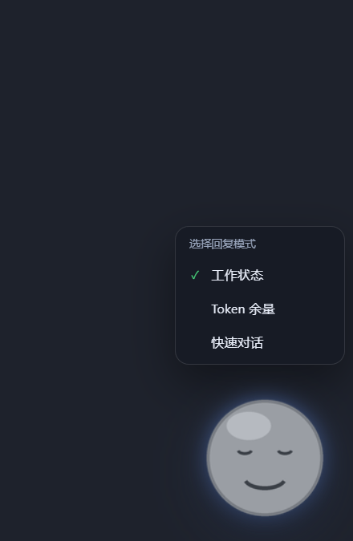
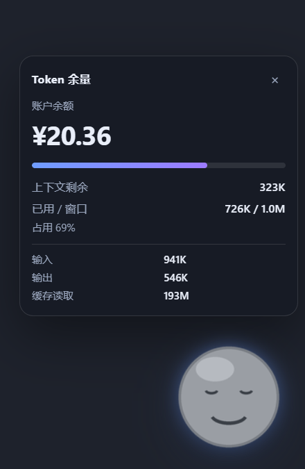
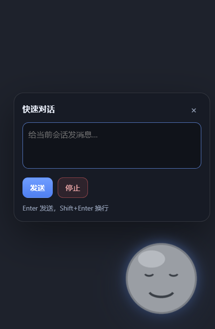

# DSH 桌宠 · dsh-desktop-pet

一只真正浮在桌面上的桌宠，作为 DSH 插件运行：

- **独立透明窗口**，始终置顶，DSH 最小化到后台时它仍留在桌面上；
- **左键**压扁一下并唤出当前模式的面板，**3 秒后自动收起**；
- **右键**弹出「选择回复模式」菜单（工作状态 / Token 余量 / 快速对话）；
- **拖动** 1:1 跟手，松手即停，位置会记住；
- **像素级命中**：只有画出来的桌宠挡鼠标，透明像素直接穿透到桌面；
- 面板内容：会话标题/状态/更新时间、账户余额、上下文与 Token 用量、快速对话与停止。


| 选择模式 | Token 余量 | 快速对话 |
| --- | --- | --- |
|  |  |  |

## 安装

### 通过 DSH 插件市场（推荐）

DSH 没有官方市场；Discover 列出的是用户自己添加的 index 源。启用方式：

1. 打开 **Plugins** 页面，在 **Experimental plugins** 旁点 **More**，打开 **Custom plugin markets**；
2. 切到 **Discover**，添加 index 地址：

   ```
   https://raw.githubusercontent.com/Chamfer-dev/dsh-pet/main/market/index.json
   ```

3. 搜索「桌宠」「pet」或「desktop pet」，安装 **DSH 桌宠**。

安装时 pnpm 会从本仓库的固定 commit 拉取代码，并自动安装 `electron` 与 `koffi` 依赖。

### 手动安装

在 DSH profile 目录（`~/.dsh/profiles/<name>`）执行：

```bash
pnpm add git+https://github.com/Chamfer-dev/dsh-pet.git#<commit>
```

然后把 `dsh-desktop-pet` 加入该 profile 的 `dsh.profile.bundles`，重启 DSH。

## 使用

- **左键**：压扁 + 打开当前模式面板，3 秒后自动收起（在面板内操作会重新计时）；
- **右键**：选择回复模式，选中后头顶提示「Token 余量 · 左键打开」；
- **拖动**：按住桌宠移动，松手即停；窗口尺寸和位置不会自己变；
- 桌宠位置保存在 `%APPDATA%\dsh-pet-window\window-state.json`。

## 换桌宠形象

默认形象是由 `tools/make_smiley.py` 生成的灰色小笑脸。资源在 `window/assets/`：

```json
{
  "frameWidth": 160,
  "frameHeight": 160,
  "states": {
    "idle":    { "image": "idle.png",    "frames": 2, "fps": 2, "loop": true },
    "working": { "image": "working.png", "frames": 2, "fps": 3, "loop": true },
    "waiting": { "image": "waiting.png", "frames": 2, "fps": 2, "loop": true }
  }
}
```

- 每个状态是一张**横向帧条**：宽 = `frameWidth × frames`，高 = `frameHeight`，背景透明；
- 用同尺寸/帧数的 PNG 覆盖 `idle.png` / `working.png` / `waiting.png` 即可，保存后自动重载；
- 点击区域取自 `idle` 帧的 alpha 轮廓：画成什么样就只有什么样接收鼠标，透明处穿透；想把可点范围画大，就在 `idle` 里画大轮廓；
- 改帧尺寸时同步改 `window/pet.css` 里 `.pet` 的 `width/height` 和 `window/main.js` 的 `PET` 常量；
- `tools/make_smiley.py` 可以直接改颜色/脸型重新生成。

## 要求

- Windows 10 / 11（透明置顶窗口与像素命中依赖 Windows API）；
- DSH 0.2+，并启用插件管理；
- Node 22+（安装依赖时）。

## 开发

```bash
pnpm install
# 直接用 Electron 跑窗口（不连接 DSH，仅调试界面）
npx electron window --pet-port 0
```

目录：

```
index.js            # Host 半：启动窗口、推送状态、余额轮询、聊天/停止
cordis.patch.yml    # 往 profile 插入 dsh-desktop-pet 行
window/             # 独立 Electron 窗口（main / preload / pet.js / pet.css / assets）
tools/              # 生成默认笑脸素材
market/index.json   # DSH 插件市场 index（format 1）
docs/               # 截图
```

## License

MIT
